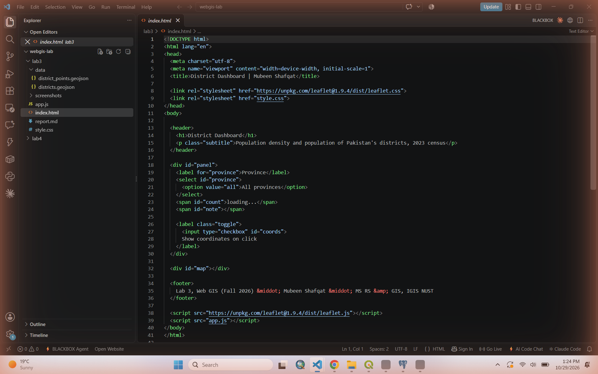
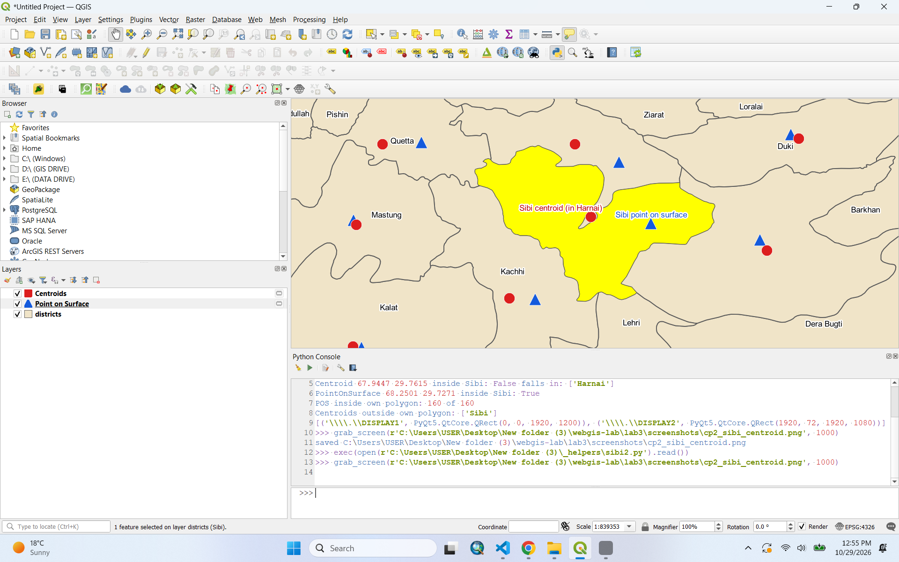
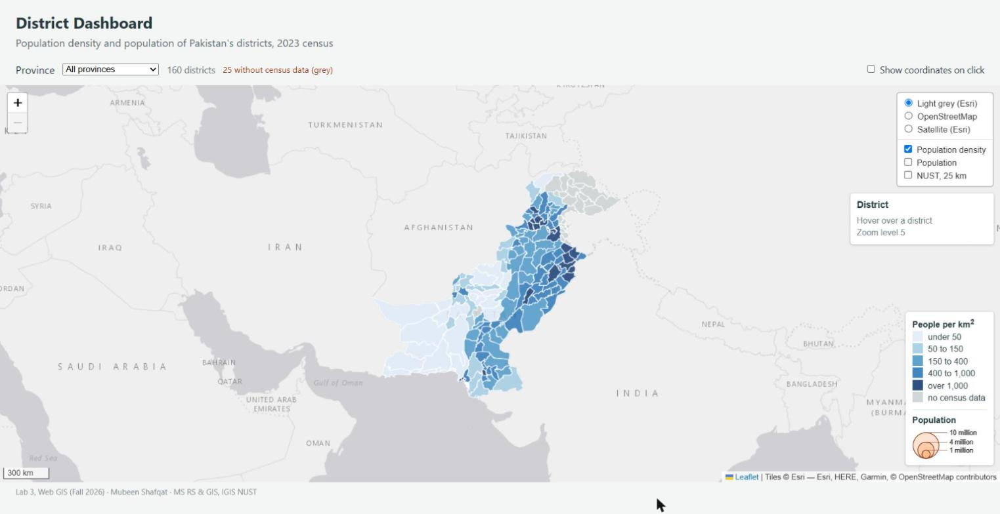
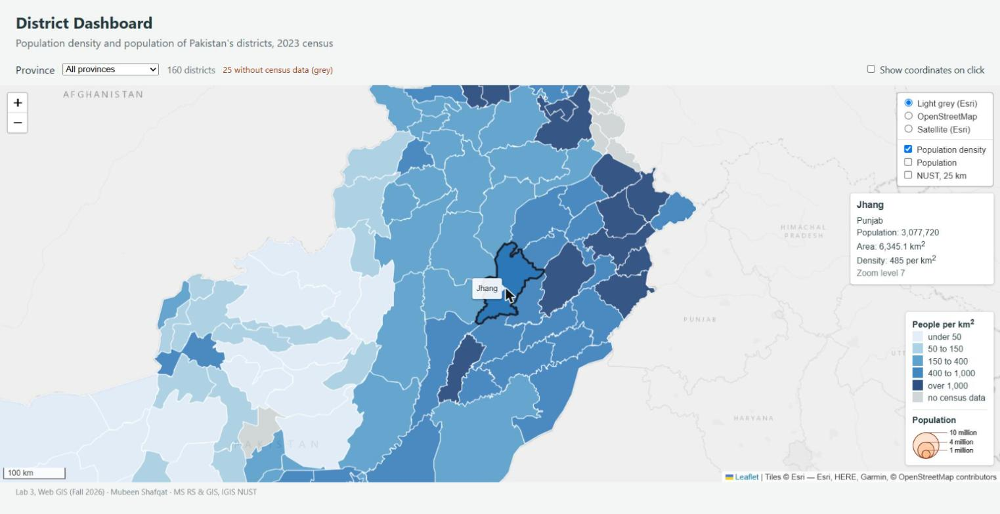
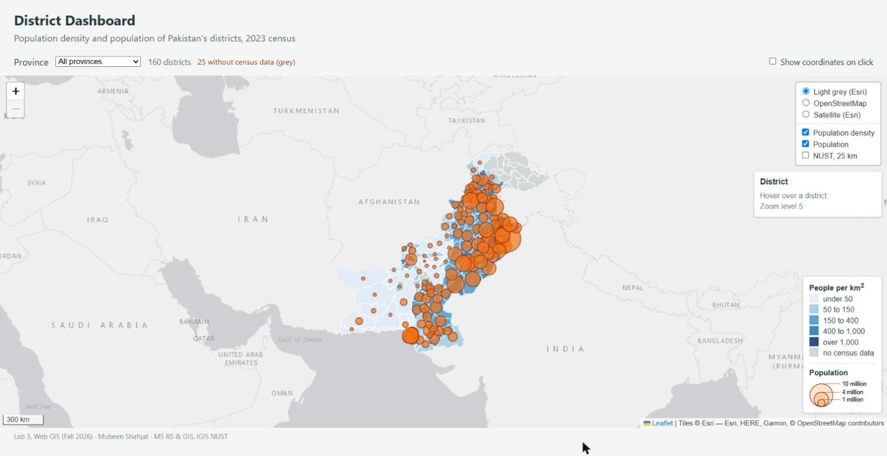
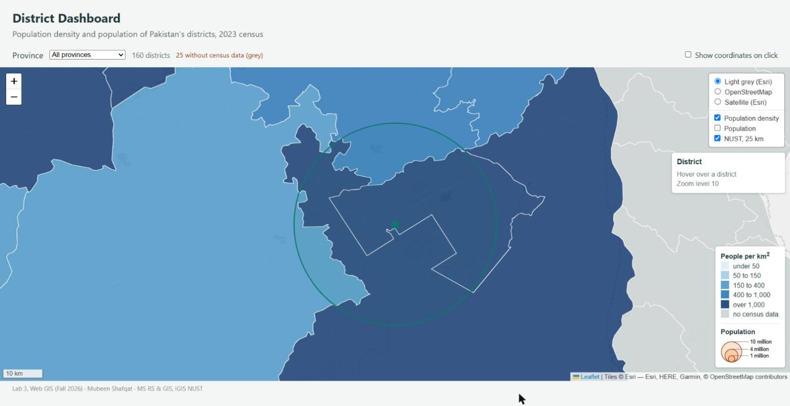
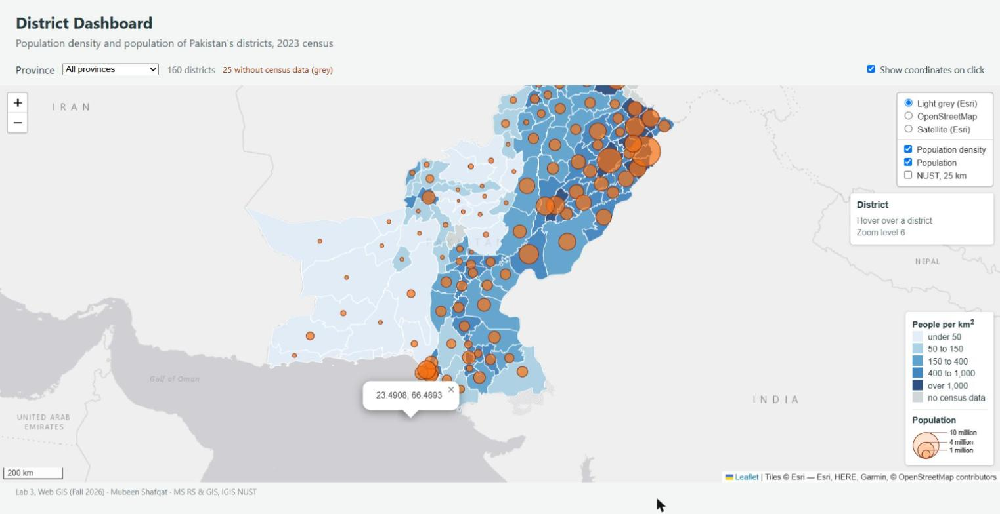
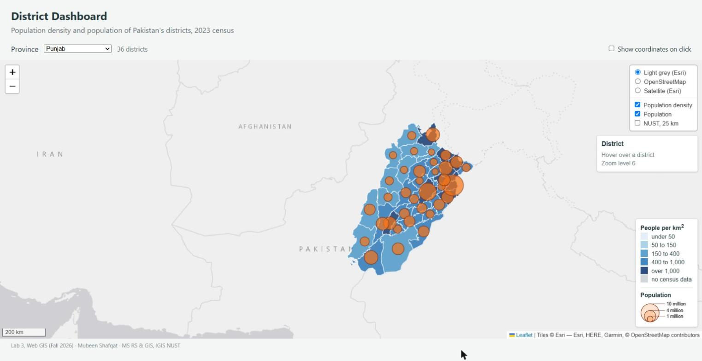

# Lab 3 Report: District Dashboard

**Name:** Mubeen Shafqat
**Programme:** MS Remote Sensing and GIS, IGIS (SCEE), NUST
**Course:** Web GIS, Fall 2026
**Live page:** https://smubeeeen.github.io/webgis-lab-494354/lab3/
**Repository:** https://github.com/smubeeeen/webgis-lab-494354

---

## Where each marking item is

| Marking item (handout) | Marks | Where to find it |
|---|---|---|
| Published dashboard with basemaps, density shading and legend | 20 | Live page; `app.js` Parts 3–4; Checkpoints 3–4 |
| Hover highlight, info panel and click to zoom | 15 | `highlight`, `unhighlight`, `zoomToDistrict`, `info` in `app.js`; Checkpoint 5 |
| Proportional symbols in their own pane, with legend | 15 | `symbols` pane, `radiusFor`, `circleFor`, legend SVG; Checkpoint 6 |
| Coordinate click handler that switches on and off | 10 | `showCoordinates` + checkbox listener; Checkpoint 7 |
| Point layer, with the centroid comparison | 10 | `data/district_points.geojson`; Checkpoint 2 (Sibi) |
| Answers to the six questions | 25 | "Answers to the questions" |
| Checkpoint screenshots and commit history | 5 | `screenshots/`; repository history |
| Extensions, Parts 8 and 9 | +10 | Checkpoints 8 and 9 (province filter, SVG/canvas table) |

---

## What I built

The Lab 2 map is now a small dashboard. It has three basemaps in a layer control, districts shaded by population density (not population), an info panel that follows the mouse, proportional circles for population in their own pane, a click handler for coordinates that can be switched on and off, a province filter, and a `?canvas` switch for the renderer test in Part 9.

Two things are different from the handout:

1. **Light basemap.** The handout uses Carto Positron. When I tested the page, every Carto tile came back as a grey image saying "API KEY REQUIRED", so the map had a tiled watermark behind it. I swapped it for Esri's *World Light Gray Canvas*. It is just as quiet, it needs no key, and it uses the same `{z}/{y}/{x}` order as Esri imagery. I left the Carto code commented out in `app.js` so the change is easy to see. Esri's attribution string replaces Carto's.
2. **Message for provinces without census data.** Part 8 asks whether the dashboard should tell the user when no circles are drawn. I think it should, so I added a short note next to the district count (see Part 8 below).

---

## Checkpoint 1: Project set-up



`lab3/` holds `index.html`, `style.css`, `app.js` and `data/` with `districts.geojson` and `district_points.geojson`.

---

## Checkpoint 2: Point layer from QGIS

I ran both **Centroids** and **Point on Surface** (Vector > Geometry Tools) on `districts.geojson`, both with "create point for each part" switched off.

**The district whose centroid falls outside it is Sibi (Balochistan).**

| | Longitude | Latitude |
|---|---|---|
| Centroid | 67.9447 | 29.7615 |
| Point on surface | 68.2501 | 29.7271 |

Sibi is a single polygon, but it is shaped like a hook bent around its neighbour, so its centre of mass falls outside it, inside **Harnai**. On a proportional symbol map, Sibi's circle would sit in Harnai and anyone reading the map would give Sibi's population to Harnai. Point on Surface always puts the point inside the polygon, and for this layer it was inside for all 160 districts (I checked every point against its own polygon).



**Export of the Point on Surface layer** (GeoJSON, EPSG:4326, `COORDINATE_PRECISION=5`):

- File: `lab3/data/district_points.geojson`
- Size: **35,729 bytes (about 35 KB)**
- Features: **160**, one per district. Every point keeps all the attributes of its district, including `pop_2023`.

---

## Checkpoint 3: Basemaps and tile URLs


One of the Esri imagery requests at zoom 5 over Pakistan:

```
https://server.arcgisonline.com/ArcGIS/rest/services/World_Imagery/MapServer/tile/5/13/22
```

Esri's template is `{z}/{y}/{x}`, so:

- `5` = zoom level
- `13` = **row** (y)
- `22` = **column** (x)

As a check: at zoom 5 the world is 2^5 = 32 tiles across. Longitude 69° E gives (69 + 180) / 360 × 32 = 22.1, so column 22. Latitude 30° N gives row 13 in the Web Mercator tile scheme. OSM and the Esri light grey tiles cover the same area, but the OSM URL puts the numbers the other way round (`.../5/22/13.png`).

---

## Checkpoint 4: Density map, legend and layer control



With the breaks 50 / 150 / 400 / 1,000 people per km², the 135 districts that have census data fall into the classes as **20, 18, 34, 41 and 22**. This matches the numbers in the handout. The other 25 districts are grey.

---

## Checkpoint 5: Hover highlight and info panel



Example from the info panel: **Jhang, Punjab**. Population 3,077,720, area 6,345.1 km², density 485 per km².

---

## Checkpoint 6: Proportional circles and the NUST overlay






What I saw when zooming from 5 to 10 with the NUST overlay on:

- The **`L.circleMarker`** (6 px) stays the same size on screen at every zoom. Its radius is in pixels.
- The **`L.circle`** (25 km) grows with every zoom step. At zoom 5 it is no bigger than the 6 px marker, just a dot on Islamabad. At zoom 10 it is a ring about 390 px across that fills most of the map's height, and one more zoom step would make it larger than the map. Its radius is in metres on the ground, so it keeps the same ground size while the map scale changes.
- Measured against the scale bar at zoom 10 (the 10 km bar is about 75 px, the radius about 195 px), the circle's radius comes to about 25 km, so its diameter is about 50 km, as expected. (Web Mercator stretches distances by about 1/cos(33.6°) ≈ 1.2 at this latitude. Leaflet corrects for this when it draws `L.circle` and in the scale bar, so the two agree.)

---

## Checkpoint 7: Map events



My notes from the three steps:

1. **Checkbox ticked, click on the sea south of Karachi:** a popup shows the coordinates, e.g. `23.4908, 66.4893`. **Then click on a district:** both handlers run. The district's own `click` handler (`zoomToDistrict`) zooms the map to that district. The click also bubbles up to the map, so `showCoordinates` opens a coordinate popup at the point I clicked. The two do not interfere: the map zooms in and the popup stays at the clicked point. Clicking on top of a population circle only gives the popup and no zoom, because the circles have no click handler of their own and sit above the polygons in the `symbols` pane.
2. **Checkbox ticked, click on the legend:** nothing happens, because the legend calls `L.DomEvent.disableClickPropagation`. When I removed that line and reloaded, clicking the legend opened a coordinate popup for whatever point of the map was under the legend. The click went straight through the control to the map. I put the line back.
3. **Checkbox unticked:** clicks on the sea do nothing. `map.off('click', showCoordinates)` removed the handler.

---

## Checkpoint 8 (extension): Province filter



After changing the province, the two overlays in the layer control still switch the rebuilt layers on and off. This is because the control holds the two `featureGroup`s, and only their contents are replaced.

**Gilgit Baltistan:** the count reads **14 districts**, but no circles appear. All 14 GB districts have `pop_2023 = null`, because the 2023 census did not cover Gilgit-Baltistan (or Azad Kashmir). `hasPopulation` filters them out before `pointToLayer` is called, so the circle layer is empty. The polygons are still drawn, in the grey "no census data" colour.

Should the dashboard say so? I think yes. An empty layer looks the same as a broken one. A user who sees 14 districts and no circles could think the population layer failed to load, or that the population is zero. So `draw()` now counts the circles. If there are districts but no circles, it shows *"No 2023 census figures for this province, so no circles are drawn"*. If only some districts are missing data, it shows how many are grey.

---

## Checkpoint 9 (extension): SVG or canvas

Times are the `draw(all)` value printed in the console. I reloaded five times in each mode (Chrome on my laptop, Live Server).

| | SVG | Canvas |
|---|---|---|
| Five runs, ms | 257.9, 62.6, 104.7, 87.7, 65.0 | 330.0, 65.3, 69.5, 86.5, 77.8 |
| `draw(all)`, median of five, ms | **87.7** | **77.8** |
| Elements inside `leaflet-overlay-pane` | 1 `<svg>` holding 1 `<g>` and 160 `<path>` (162 elements). The 135 circles are in a second `<svg>` in the `symbols` pane | 1 `<canvas>`, nothing inside it |
| Hover highlight still works? | Yes | **No** (see below) |
| Can you inspect one district in Elements? | Yes, every district is its own `<path>` | No, it is all pixels on one canvas |


**Hover in canvas mode.** I did not expect this one. In canvas mode, hovering over districts does nothing, but the circle tooltips still work. The reason is that Leaflet makes one canvas per pane. The `symbols` pane (z-index 450) gets its own canvas, and that canvas is the full size of the map, sitting on top of the overlay pane's canvas. All mouse events go to the top canvas. Leaflet only checks those events against the circles, so the polygons underneath never get a `mouseover`. (`document.elementFromPoint` over a district returns the canvas in `leaflet-symbols-pane`.) In SVG mode this does not happen, because SVG only catches events on the painted shapes and lets the rest through. One fix would be to draw the circles with the same renderer as the districts in canvas mode, so a single canvas does the hit-testing for both. But then `bringToFront()` on a hovered district would draw it over its circle again (the Question 4 problem), so the highlight would have to stop calling `bringToFront` in that mode.

**Reading the result.** With 160 polygons and 135 circles, canvas was about 10 ms faster on the median, but the runs overlap a lot (SVG's fastest run, 62.6 ms, was quicker than every canvas run), and the first load of each mode was much slower (258 and 330 ms) because nothing was cached yet. That is why I used the median. At this size the difference is too small to matter. For the **tehsil layer (admin level 3)** I would expect canvas to win clearly. There are several times as many features, and each has more vertices. In SVG every feature is a DOM node, and the browser has to lay out, style and hit-test each one, again on every pan and zoom. That cost grows with the number of nodes. Canvas has one element, and its cost depends mostly on the number of vertices drawn. With a few thousand features the DOM overhead of SVG is what slows the map down, which is the threshold the lecture gave. The trade-off is what the table shows: with canvas you cannot inspect or style single features in the DOM, and hover depends on Leaflet's own hit-testing.

---

## Answers to the questions

**1. Lab 2 shaded districts by population. Name one large, thinly populated district and one small, crowded one, and explain how each would mislead on the Lab 2 map.**

*Large and thin:* **Khuzdar** (Balochistan) has about 1.0 million people on 30,955 km², so 32 people per km². On a population map it gets a middle class colour, and because it is one of the biggest polygons in the country, it fills a large part of the map with that colour. The reader sees a big, fairly dark area and takes it as a well populated region, when it is mostly empty desert and mountains. Chagai (44,477 km², 6 per km²) has the same problem to a lesser degree. Here the eye mostly reads the area of the shape and not the value.

*Small and crowded:* **Central Karachi** has 3.8 million people on only 65 km², about 58,700 per km², the highest in the dataset. On the Lab 2 map it is in the same class as many large rural districts with a similar headcount. At national scale it is only a few pixels, so the most crowded place in Pakistan almost disappears. Lahore (13 million, about 7,500 per km²) is the same: very important, but small on the map.

So a count choropleth over-weights big empty districts and hides small dense ones. That is why the polygons should be coloured by density, and the count shown with a symbol.

**2. `radiusFor` takes a square root. What would the map suggest about Lahore against a district of 3 million if it did not?**

Lahore has 13,004,135 people, about 4.3 times as many as a 3 million district. With the square root, Lahore's radius is 22.5 px and the other's is 10.8 px. The ratio of the radii is about 2.1, so the ratio of the areas is about 4.3, which is correct. If the radius were proportional to population, the radius would be 4.3 times larger, and the **area 4.3² ≈ 19 times larger**. People judge circles by their area, so Lahore would look about nineteen times as populous as the 3 million district instead of about four times. The large cities would cover everything around them, and the smaller districts would shrink to dots.

**3. Why does the layer control hold `districtGroup` rather than the `L.geoJSON` layer itself?**

Because the `L.geoJSON` layer does not last. Every call to `draw(province)` throws the old layer away and builds a new one. If the control held a reference to the first `L.geoJSON`, it would still point to a layer that is no longer on the map after the first province change. Ticking the box would add and remove an old layer, and the visible one would no longer respond to the control. `districtGroup` is made once and stays on the map. The control switches the group, and `draw` only clears and refills what is inside it. The same goes for `circleGroup`.

**4. What would go wrong if the circles were drawn in `overlayPane` instead of the `symbols` pane? Describe what the user would see when hovering.**

The polygons and circles would then be in the same SVG, and their order would be the order they were added or last brought forward. On load the circles come second, so they would look fine at first. But `highlight` calls `bringToFront()` on the district under the mouse, which moves that path to the end of the SVG, above everything, circles included. So when the user moves over a district, its circle disappears under the highlighted polygon. Moving away calls `resetStyle` but not `bringToBack`, so the district stays on top of its circle afterwards. As the user moves across the map, more and more circles get covered, and their tooltips stop working because the polygon now catches the mouse. With a pane at z-index 450 the circles are always above every polygon, whatever `bringToFront` does inside `overlayPane`.

**5. Why can `map.off` remove `showCoordinates`, when it could not remove an anonymous function passed to `map.on`?**

`map.off('click', fn)` searches the map's list of click listeners for the same function object as `fn`, and compares them by reference. `showCoordinates` is one named function, so the object passed to `on` and the object passed to `off` are the same, and the match is found. An anonymous function written inline inside `map.on(...)` is a new object that is not stored anywhere. If I write the same code again inside `map.off(...)`, that creates a second, different function object, which is equal in text but not in reference, so nothing matches and the original listener stays. (Calling `map.off('click')` with no function would remove it, but it would also remove every other click handler on the map, which is not what we want.)

**6. On the NUST overlay, which circle would you use to show a 25 km evacuation zone, and which to mark the campus on a national map? Why?**

- **25 km evacuation zone: `L.circle`.** The zone is a real distance on the ground. Its radius is in metres, so it covers the right area at every zoom and lines up with the roads and settlements it includes. A pixel circle would cover 25 km only at one zoom level and would be wrong at all the others.
- **Campus on a national map: `L.circleMarker`.** Here the circle is just a symbol for "NUST is here", and it has to stay visible. At zoom 5, a circle the true size of the campus would be smaller than a pixel. A circle marker keeps a fixed screen size, so it stays clickable and readable at any zoom.

---

## Files

| File | Purpose |
|---|---|
| `index.html` | Page layout: header, panel, map |
| `style.css` | Page styling, info panel and legend |
| `app.js` | The whole dashboard, with comments marking the Part each block belongs to |
| `data/districts.geojson` | District polygons with 2023 census population (from Lab 2) |
| `data/district_points.geojson` | Point on Surface layer exported from QGIS |
| `screenshots/` | Checkpoint screenshots |

To run locally: open the `lab3` folder in VS Code, open `index.html`, and use **Live Server**. Add `?canvas` to the address to switch to the canvas renderer.
