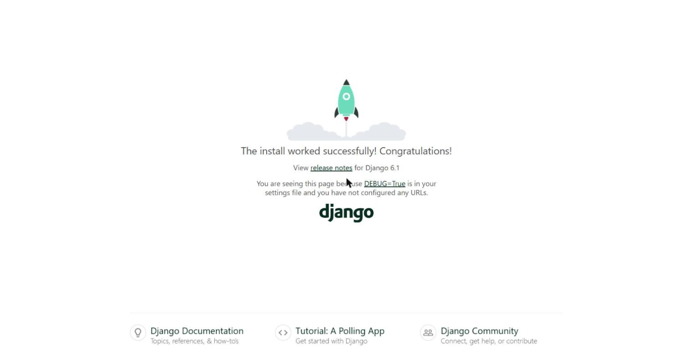
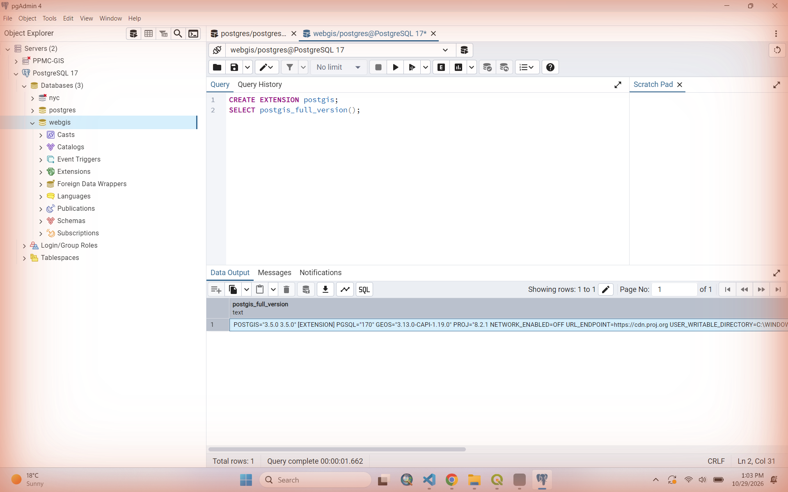
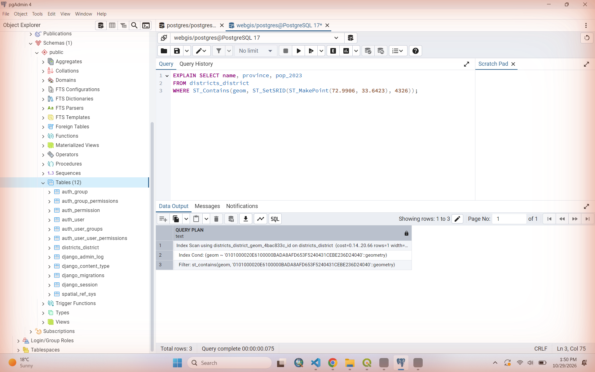
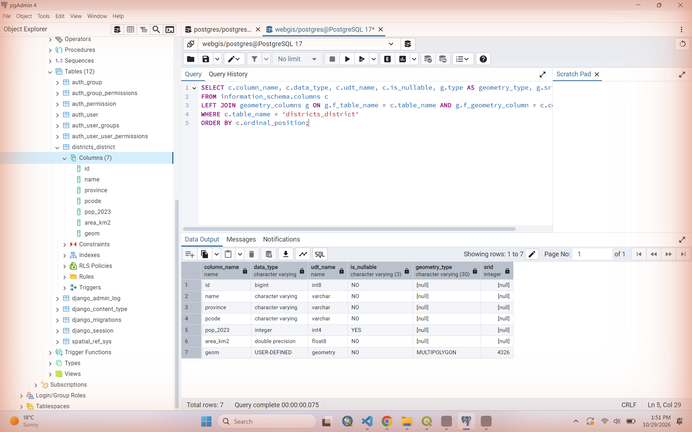
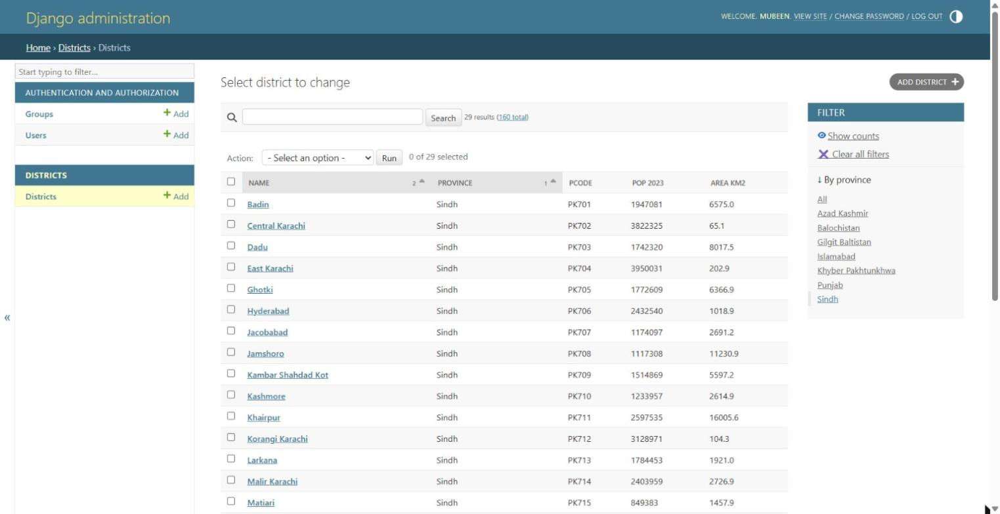
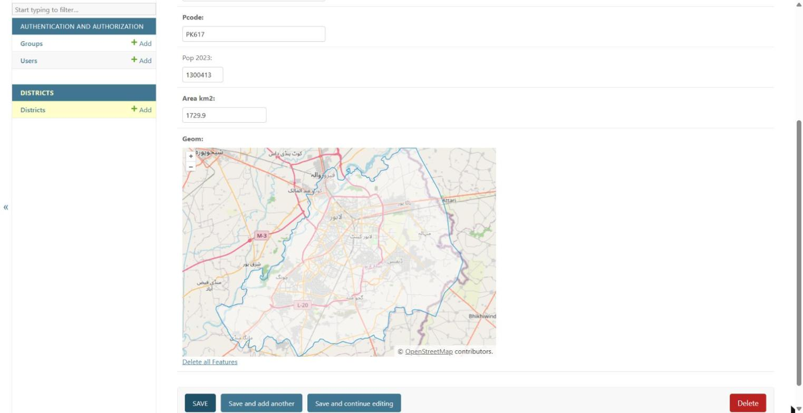
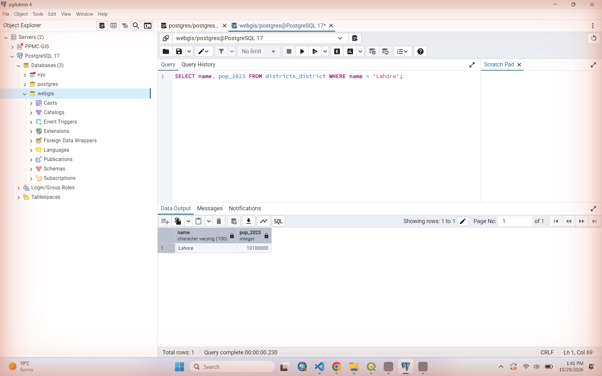
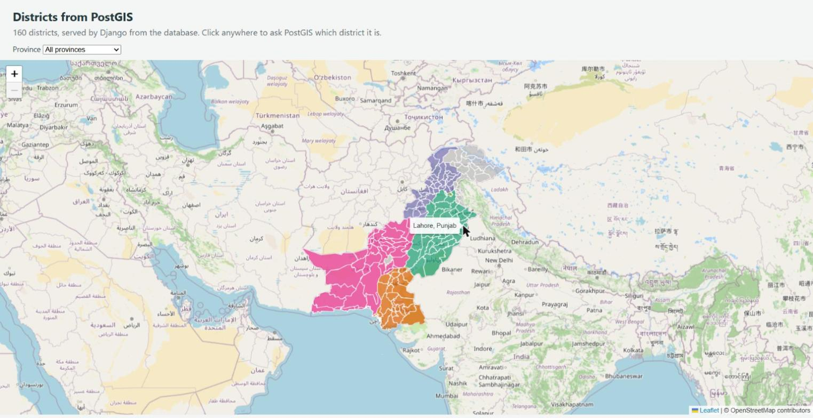
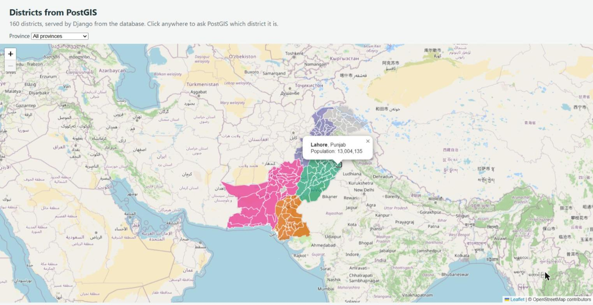

# Lab 4 Report: Getting started with GeoDjango

**Name:** Mubeen Shafqat
**Programme:** MS Remote Sensing and GIS, IGIS (SCEE), NUST
**Course:** Web GIS, Fall 2026
**Repository:** https://github.com/smubeeeen/webgis-lab-494354 (folder `lab4/`)

This lab has no live URL. The project needs a Django server and a PostGIS database, so it runs only on my own machine for now.

---

## Where each marking item is

| Marking item (handout) | Marks | Where to find it |
|---|---|---|
| Django project created and running | 10 | `manage.py`, `webgis/`; Checkpoint 1 |
| PostgreSQL and PostGIS installed, `webgis` database ready | 15 | Versions table; Checkpoint 2 |
| Django connected to PostGIS, migrations applied | 15 | `webgis/settings.py`; Checkpoint 3 |
| District model, loaded with 160 districts | 15 | `districts/models.py`, `districts/load.py`; Checkpoints 4–5 |
| Admin registered and explored, with the database edit | 10 | `districts/admin.py`; Checkpoint 6 |
| Leaflet map drawn from the Django API | 15 | `views.py`, `urls.py`, `map.html`; Checkpoint 7 |
| Report: versions, errors and answers to the six questions | 20 | Versions, Installation problems, Answers |
| Extension, Part 8 | +10 | `district_at` view, map click handler; Checkpoint 8 (incl. `EXPLAIN` and area table) |

---

## Summary

The 160 districts from Labs 2 and 3 now live in a PostGIS table (`districts_district`). They can be browsed, filtered, searched and edited in the Django admin, and they are drawn by Leaflet from a GeoJSON API that Django builds from the database on each request. I also did the Part 8 extension (a "which district is this point in" query) and two items from the optional list:

- **Province drop-down that filters in the database.** The page calls `/api/districts/?province=...`, so PostGIS sends only that province instead of the browser hiding features (optional item 1).
- **Districts with no census figure drawn in grey**, using the `pop_2023` value the API already sends (optional item 4).

The drop-down is filled from the database in the view (`values_list("province").distinct()`), so it never lists a province that has no rows.

---

## Versions on my machine

| Software | Version |
|---|---|
| Windows | 11 Pro |
| Python | 3.13.14 (in the `venv`) |
| Django | 6.1.2 |
| psycopg | 3.3.6 (binary) |
| PostgreSQL | 17.2 |
| PostGIS | 3.5.0 |
| GEOS (in PostGIS) | 3.13.0 |
| PROJ (in PostGIS) | 8.2.1 |
| GDAL (from QGIS 3.26.3, used by Django) | 3.5.1 |
| GEOS (from QGIS 3.26.3, used by Django) | 3.10.3 |

`postgis_full_version()` returned:

```
POSTGIS="3.5.0 3.5.0" [EXTENSION] PGSQL="170" GEOS="3.13.0-CAPI-1.19.0" PROJ="8.2.1 NETWORK_ENABLED=OFF URL_ENDPOINT=https://cdn.proj.org USER_WRITABLE_DIRECTORY=C:\WINDOWS\ServiceProfiles\NetworkService\AppData\Local/proj DATABASE_PATH=C:\Program Files\PostgreSQL\17\share\contrib\postgis-3.5\proj\proj.db" (compiled against PROJ 8.13.0) LIBXML="2.12.5" LIBJSON="0.12" LIBPROTOBUF="1.2.1" WAGYU="0.5.0 (Internal)"
```

---

## Installation problems and how I fixed them

PostgreSQL 17 and pgAdmin were already on my laptop. I added PostGIS 3.5 to it and created the `webgis` database in pgAdmin. Three things went wrong after that.

**1. There is no `py` launcher on my laptop.**
My Python 3.13 is the Microsoft Store version, which does not install the `py` launcher. Every `py` command failed with:

```
py : The term 'py' is not recognized as the name of a cmdlet, function, script file, or operable program. Check the
spelling of the name, or if a path was included, verify that the path is correct and try again.
```

The setup script was worse than a clear failure. Its version check looked at `$LASTEXITCODE` after the failed `py -3.14 --version`, but a "command not found" error doesn't change `$LASTEXITCODE`. So it printed `Using: py -3.14`, the `py -3.14 -m venv venv` line failed, and the activation failed too:

```
& : The term '.\venv\Scripts\Activate.ps1' is not recognized as the name of a cmdlet, function, script file, or
operable program.
```

Everything after that ran with my main Python, so Django was installed there instead of in a virtual environment. I fixed it by making the venv with the Python that *is* on `PATH` (`python --version` gives 3.13.14, which Django 6.1 accepts), then running the setup again:

```
python -m venv venv
venv\Scripts\Activate.ps1
python -c "import sys, django; print(sys.executable, django.get_version())"
...\lab4\venv\Scripts\python.exe 6.1.2
```

**2. No OSGeo4W, and one of my two QGIS folders has no GDAL.**
There is no `C:\OSGeo4W` on my laptop, so I pointed `OSGEO4W_ROOT` at a QGIS install instead (the handout's fallback). I have two QGIS folders. `C:\Program Files\QGIS 3.36.2` turned out to be incomplete: its `bin` folder has no `gdal*.dll` and there is no `share\proj\proj.db`. The first attempt picked that folder. `C:\Program Files\QGIS 3.26.3` has `gdal305.dll` and `proj.db`, so I set:

```
setx OSGEO4W_ROOT "C:\Program Files\QGIS 3.26.3"
```

Django then found GDAL 3.5.1 and GEOS 3.10.3 (Checkpoint 3). These are older than the ones in PostGIS, but nothing in this lab needed anything newer.

**3. Every OpenStreetMap tile on my map said "Access blocked".**
The districts drew correctly, but the basemap was a grid of 403 tiles: *"Access blocked. App is not following the tile usage policy of OpenStreetMap's volunteer-run servers"*. The response headers from `runserver` include `Referrer-Policy: same-origin` (Django's `SecurityMiddleware` default). That means the browser sent no `Referer` to tile.openstreetmap.org, and OSM blocks tile requests without one. The admin's map was fine, and so was Lab 3 under Live Server, which doesn't send that header. I fixed it in `map.html` by giving the tile layer its own policy, which sends only `http://127.0.0.1:8000` as the referrer:

```js
L.tileLayer('https://tile.openstreetmap.org/{z}/{x}/{y}.png', {
  maxZoom: 19,
  referrerPolicy: 'strict-origin-when-cross-origin',
  attribution: '&copy; OpenStreetMap contributors'
}).addTo(map);
```

Apart from these, `check`, `migrate`, the loader and the ORM lines all worked.

---

## Checkpoint 1: Django installed



```
> python -m django --version
6.1.2
```

---

## Checkpoint 2: PostGIS database



---

## Checkpoint 3: Django connected to PostGIS

```
> python manage.py shell -c "from django.contrib.gis import gdal, geos; print(gdal.gdal_version(), geos.geos_version())"
b'3.5.1' b'3.10.3-CAPI-1.16.1'

> python manage.py check
System check identified no issues (0 silenced).

> python manage.py migrate
Operations to perform:
  Apply all migrations: admin, auth, contenttypes, districts, sessions
Running migrations:
  No migrations to apply.
```

That is the output of my second run. The first run had already applied the migrations, but its log didn't keep that output (see problem 1). `showmigrations` confirms that all of them are applied:

```
> python manage.py showmigrations
admin
 [X] 0001_initial
 [X] 0002_logentry_remove_auto_add
 [X] 0003_logentry_add_action_flag_choices
auth
 [X] 0001_initial
 ...
 [X] 0012_alter_user_first_name_max_length
contenttypes
 [X] 0001_initial
 [X] 0002_remove_content_type_name
districts
 [X] 0001_initial
sessions
 [X] 0001_initial
```



---

## Checkpoint 4: The model and its SQL

```
> python manage.py sqlmigrate districts 0001
BEGIN;
--
-- Create model District
--
CREATE TABLE "districts_district" ("id" bigint NOT NULL PRIMARY KEY GENERATED BY DEFAULT AS IDENTITY, "name" varchar(100) NOT NULL, "province" varchar(50) NOT NULL, "pcode" varchar(10) NOT NULL UNIQUE, "pop_2023" integer NULL, "area_km2" double precision NOT NULL, "geom" geometry(MULTIPOLYGON,4326) NOT NULL);
CREATE INDEX "districts_district_pcode_affbafd9_like" ON "districts_district" ("pcode" varchar_pattern_ops);
CREATE INDEX "districts_district_geom_4bac833c_id" ON "districts_district" USING GIST ("geom");
COMMIT;
```

The two lines that matter are `"geom" geometry(MULTIPOLYGON,4326) NOT NULL` and the `USING GIST` index on `geom`. I also noticed a third index that I hadn't asked for: `pcode` gets a `varchar_pattern_ops` index because `unique=True` makes it indexed, and Django adds the pattern-ops version so that `LIKE 'PK1%'` searches can use it as well.



---

## Checkpoint 5: Loading the districts and the ORM

```
> python manage.py shell -c "from districts import load; load.run()"
districts : 160 features, Unknown geometry
152 polygons wrapped as multipolygons
160 districts saved
```

GDAL reports the layer's geometry type as **Unknown**, because the file mixes Polygon and MultiPolygon. I added a counter to the loader to confirm the handout's figure: 152 features were wrapped, and the other 8 were already multipolygons.

```
>>> District.objects.count()
160
>>> District.objects.filter(province="Sindh").count()
29
>>> District.objects.filter(pop_2023__isnull=True).count()
25
>>> lahore = District.objects.get(name="Lahore")
>>> lahore.pop_2023
13004135
>>> lahore.geom.geom_type
'MultiPolygon'
>>> lahore.geom.num_coords
238
```

Lahore is stored as a MultiPolygon even though it is one piece in the file. The loader wrapped it, which is exactly what it is supposed to do.

---

## Checkpoint 6: The admin panel





What I did and saw:

- The admin home lists **Users** and **Groups** (from Django) and **Districts** (mine).
- Filtering by **Sindh** gives **29** districts. Searching for `karachi` gives **6** results (the Karachi districts).
- Sorting by `pop_2023` from high to low does **not** put Lahore first. The first 25 rows are the districts with no census figure (shown as "-"), because PostgreSQL puts `NULL` first in a descending sort. After them come Lahore, Faisalabad and Rawalpindi.
- Lahore's page shows the boundary on an OpenStreetMap basemap drawn with OpenLayers (`ol.js` and `OLMapWidget.js` are the scripts the page loads), not Leaflet. The admin uses its own mapping library.
- I changed Lahore's population to 13,100,000, saved, and ran `SELECT name, pop_2023 FROM districts_district WHERE name = 'Lahore';` in pgAdmin. The new value was already there. I then set it back to **13004135**.
- **History** on Lahore's page lists both changes, with my username, the time and "Changed Pop 2023". This comes from the `django_admin_log` table that `migrate` created.

---

## Checkpoint 7: Leaflet fed by Django




| Request | Features | Size |
|---|---|---|
| `/api/districts/` | 160 | 1,026,603 bytes (about 1.0 MB) |
| `/api/districts/?province=Sindh` | 29 | 173,769 bytes (about 170 KB) |

The full response is about 10% larger than the 933 KB `districts.geojson` from Lab 3, even though the coordinates are the same (still 5 decimals). Looking at the raw response, I found three causes. Django's serializer puts a space after every `,` and `:` (that alone is a lot of characters with tens of thousands of coordinate pairs). It adds an `id` to every feature. And the 152 wrapped polygons now have an extra level of `[ ]` because they are MultiPolygons. That doesn't matter at 1 MB, but for bigger layers gzip on the server, or a simplified copy for small scales, would be worth adding.

`Ctrl+U` shows `const DISTRICTS_URL = "/api/districts/";`. Django had already replaced the `` tag before the browser got the page.

---

## Checkpoint 8 (extension): A spatial question

`/api/where/?lat=33.6423&lng=72.9906` returns:

```json
{"district": "Islamabad", "province": "Islamabad", "pop_2023": 2363863}
```

A point in the Arabian Sea returns `{"district": null}`, and `?lat=abc` returns HTTP 400 with `{"error": "give lat and lng as numbers"}`. Clicking Lahore on the map gives a popup with **Lahore, Punjab, Population: 13,004,135**.



To check that the index is actually used, I ran `EXPLAIN` on the same query in pgAdmin:

```
Index Scan using districts_district_geom_4bac833c_id on districts_district
  Index Cond: (geom ~ '0101000020E6100000...'::geometry)
  Filter: st_contains(geom, '0101000020E6100000...'::geometry)
```

PostGIS first uses the GiST index to find the bounding boxes that contain the point (`~`), and only then runs the exact `ST_Contains` on those few rows.

**Area comparison:**

| name | stored | geodesic | web_mercator | Mercator ÷ geodesic | Approx. latitude | 1 / cos²(lat) |
|---|---|---|---|---|---|---|
| Gwadar | 11,574 | 11,574 | 14,244 | 1.23 | 25.4° | 1.23 |
| Lahore | 1,730 | 1,730 | 2,385 | 1.38 | 31.5° | 1.37 |
| Gilgit | 4,016 | 4,015 | 6,133 | 1.53 | 35.9° | 1.52 |

The stored value (from the source data) and the geodesic area agree to within 1 km². Web Mercator overstates every district, and the further north the district is, the more it overstates. Mercator stretches distances by 1/cos(lat) in both directions, so areas grow by 1/cos²(lat). The ratio in the table matches that formula for all three districts (to within 0.01): about 23% too large at Gwadar, 38% at Lahore and 53% at Gilgit. This is the same thing we found in Lab 2 Part 9, now done in one SQL statement. In practice it means that `ST_Area` in 3857 (or on degrees in 4326) should never be used for real areas. Cast to `geography` or use an equal-area projection instead.

---

## Answers to the questions

**1. In Labs 2 and 3, every visitor downloaded the whole GeoJSON file. What can a page backed by Django and PostGIS do instead? Give two examples from this lab.**

The server can send only what the page needs, worked out by the database at the time of the request:

- **Filter in the database:** `/api/districts/?province=Sindh` returns 29 features (about 170 KB) instead of 160 (about 1 MB). The `WHERE province = 'Sindh'` runs in PostgreSQL, and the browser never receives the rest. My province drop-down uses this.
- **Ask a question instead of downloading the data:** `/api/where/?lat=..&lng=..` sends one point and gets back a tiny JSON answer. The point-in-polygon test runs in PostGIS (using the spatial index), so the browser doesn't need any polygons at all to find out which district a point is in.

A third advantage is that the data is live. An edit in the admin shows up on the next page load, with no file to regenerate and re-upload.

**2. Why does `settings.py` read the database password from an environment variable, instead of containing the password itself?**

Because `settings.py` is committed to GitHub, and my repository is public. A password written in the file is published to anyone who opens the repo, and it stays in the Git history even if I delete it later. With `os.environ.get("WEBGIS_DB_PASSWORD")` the code only says *where* to find the password, and the value stays on my machine. It also lets the same file work on different machines (my laptop, a lab PC, a server later), each with its own password, without editing the code. I did the same for the port and host (`WEBGIS_DB_PORT`, `WEBGIS_DB_HOST`), with the normal values as defaults. (The `SECRET_KEY` should get the same treatment before this goes anywhere near production.)

**3. In Part 4, the SQL ends with an index created `USING GIST`. What does it do, and which query in this lab benefits from it?**

A GiST index on a geometry column is an R-tree-like structure built on the **bounding boxes** of the geometries. For a spatial filter, PostGIS first asks the index which bounding boxes could match, which is quick, and then runs the exact (expensive) geometry test only on those candidates. Without the index, every row's full polygon would have to be tested. The query that benefits is Part 8's `District.objects.filter(geom__contains=point)`, i.e. `ST_Contains`. My `EXPLAIN` output above shows an *Index Scan using districts_district_geom_..._id* with the `~` (bounding-box contains) condition before the `st_contains` filter. With 160 rows the time saved is tiny, but for a layer of tehsils or buildings it makes a very large difference.

**4. The loading script wraps some geometries in a `MultiPolygon`. What would happen without that step, and why?**

The `geom` column is typed `geometry(MULTIPOLYGON,4326)`, so PostGIS only accepts multipolygons in it. 152 of the 160 features are plain Polygons. Without the wrap, the first `District.objects.create(...)` with a Polygon would fail with a PostGIS error along the lines of *"Geometry type (Polygon) does not match column type (MultiPolygon)"*. In this file the very first feature (Bagh, AJK) is a Polygon, so the script would crash on the first row. Because the script starts with `District.objects.all().delete()`, the table would end up empty. Wrapping a polygon as a one-part multipolygon doesn't change the shape at all, it only changes the type. That's also why the handout doesn't use `LayerMapping`, which rejects a layer whose type GDAL reports as `Unknown`.

**5. Who should have an admin login for a district dataset like this, and who should not?**

*Should:* the small number of people who are responsible for keeping the data correct, e.g. the GIS officer or data manager who loads new census figures or fixes boundary errors, and the developer who looks after the system. Even among them, permissions should be split. A data editor can get "change district" but not "delete district", and only one or two people should be superusers.

*Should not:* the public, map viewers, students using the dashboard, or anyone who only needs to *see* the data. They should get read-only pages and APIs like `/api/districts/`. The admin can change or delete every row, and the History log records the change but does not undo it. Shared logins should also be avoided, so that History shows who actually changed what.

**6. Leaflet takes `[lat, lng]` and `Point` takes `(lng, lat)`. Where in this lab is each order used, and how does the extension's URL avoid confusing them?**

- **lat, lng (Leaflet):** `setView([30.3753, 69.3451], 5)`, `maxBounds: [[21.5, 58.5], [39.0, 80.5]]`, and `e.latlng.lat` / `e.latlng.lng` in the click handler.
- **lng, lat (x, y):** `Point(lng, lat, srid=4326)` in `views.py` (GEOS). Also the coordinates inside the GeoJSON the API returns (GeoJSON is always `[lng, lat]`), and `ST_MakePoint(72.9906, 33.6423)` in the SQL query.

The URL avoids the problem by using **named parameters**: `?lat=33.6423&lng=72.9906`. The view reads `request.GET["lat"]` and `request.GET["lng"]` by name, so their order in the URL doesn't matter, and the view itself puts them into `Point` in x/y order. If the URL had been positional (e.g. `/api/where/33.6/72.9/`), the browser and the server would have to agree on the order, which is exactly where mistakes happen.

---

## How to run

```powershell
cd lab4
python -m venv venv                         # python must be 3.12-3.14 (mine is 3.13.14)
venv\Scripts\Activate.ps1
pip install -r requirements.txt
setx WEBGIS_DB_PASSWORD "your-postgres-password"   # then open a new terminal
python manage.py migrate
python manage.py shell -c "from districts import load; load.run()"
python manage.py createsuperuser
python manage.py runserver
```

- Map: http://127.0.0.1:8000/
- API: http://127.0.0.1:8000/api/districts/ and http://127.0.0.1:8000/api/where/?lat=33.6423&lng=72.9906
- Admin: http://127.0.0.1:8000/admin/

OSGeo4W is expected at `C:\OSGeo4W`. If it is somewhere else, set `OSGEO4W_ROOT` before starting Django. On my laptop it is `C:\Program Files\QGIS 3.26.3`.
