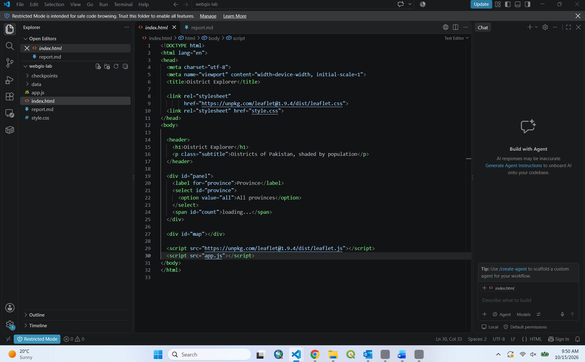
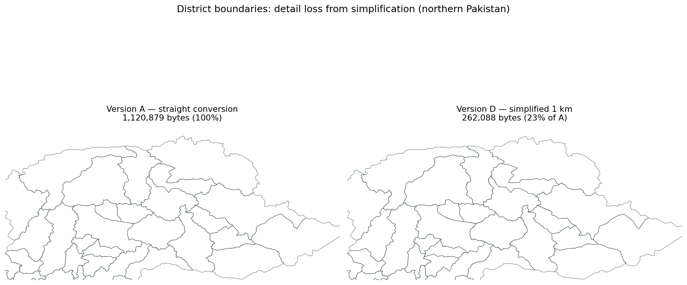
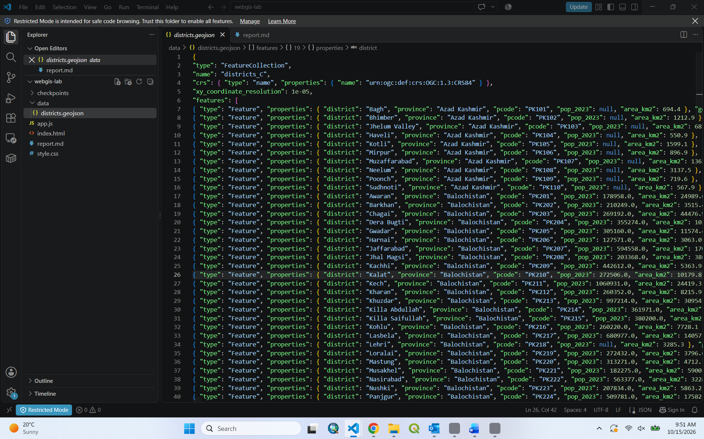
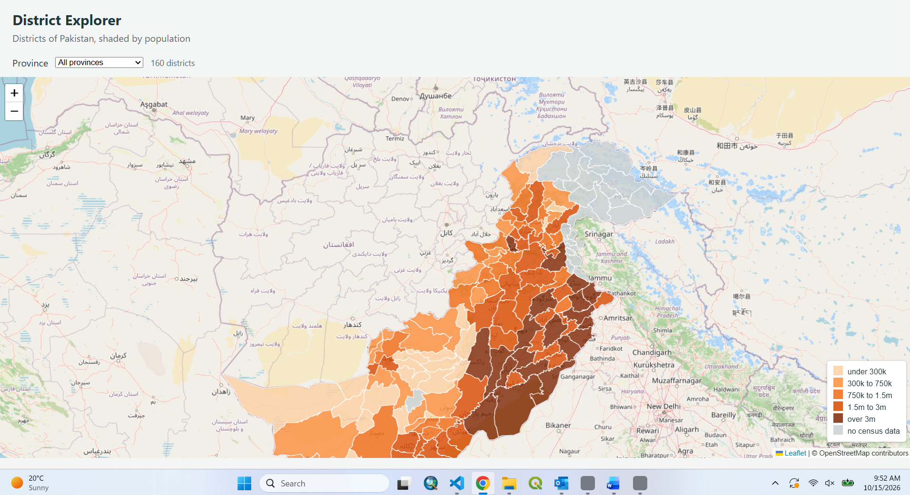
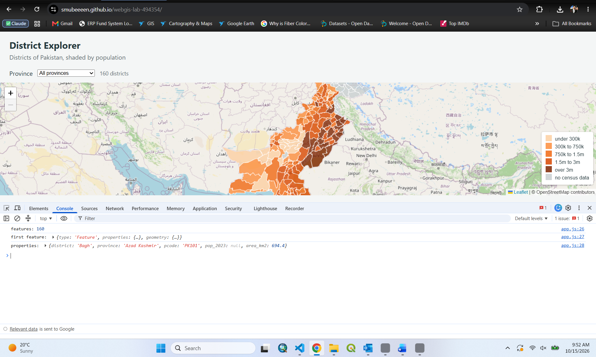
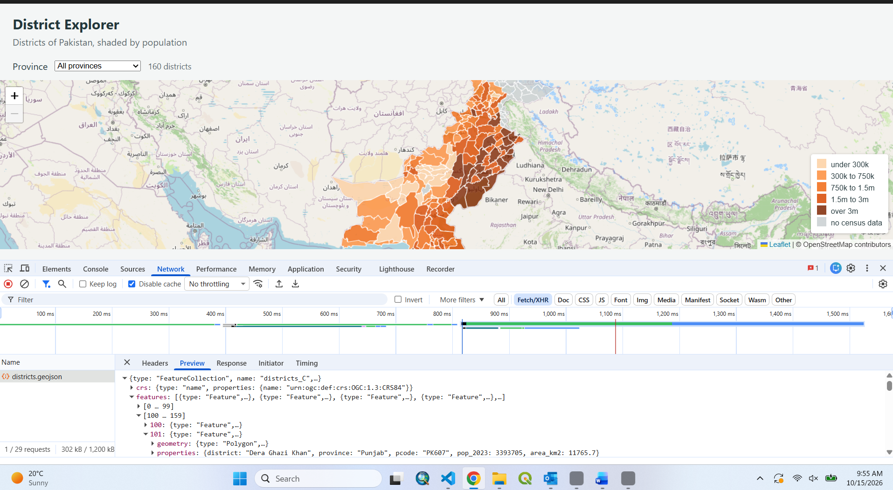
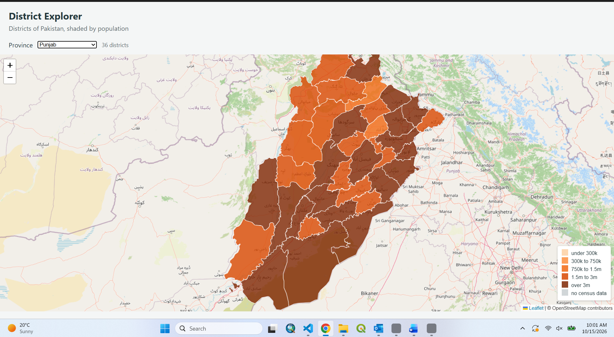

# Web GIS — Lab 02 Report
## District Explorer: building a web map from a shapefile

**Course:** Web GIS · Institute of Geographical Information Systems (IGIS), NUST
**Student:** Mubeen Shafqat
**Roll number:** 494354
**Repository:** https://github.com/smubeeeen/webgis-lab-494354
**Live site:** https://smubeeeen.github.io/webgis-lab-494354/

> **Note on method.** The data for this lab was provided on LMS as a ready-made
> GeoJSON (`districts.geojson`, 160 features, fields `district, province, pcode,
> pop_2023, area_km2`). The four size versions (A–D), the coordinate-precision
> reduction, the topology-preserving simplification, the WGS 84 → Web Mercator /
> UTM reprojections and the planimetric areas were all produced from that file
> with GDAL/GeoPandas (the programmatic equivalent of the QGIS Export, Simplify,
> Reproject and Field-Calculator steps). All numbers below are measured from my
> own files, not quoted from the lecture.

---

## Checkpoint screenshots

1. **Checkpoint 1** — VS Code showing `C:\webgis-lab` with `index.html`, `style.css`, `app.js` and an empty `data` folder.
   
2. **Checkpoint 2** — Versions A and D drawn together in QGIS so the loss of detail is visible, plus the completed measurement table (below).
   
3. **Checkpoint 3** — the five "read as text" answers (below), plus the first coordinate pair and the order confirmation.
   
4. **Checkpoint 4** — the header and the empty grey map area, address bar on `127.0.0.1`.
   
5. **Checkpoint 5** — the Console showing the feature count, the expanded first feature, and the list of distinct provinces.
   
6. **Checkpoint 6** — the Network tab showing the GeoJSON request with its size, and a selected tile request with its Preview.
   
7. **Checkpoint 7** — the shaded map with the legend visible and one popup open.
   
8. **Checkpoint 8** — two views: all provinces, and a single province selected, with the district count visible in both.
   
   
9. **Checkpoint 9** — the coordinate-system comparison table (below) and the three answers in Part 10.
   

---

## Part 3 — File size measurements

The source layer is administrative level 2 (districts) of the Pakistan Common
Operational Dataset: **160 features** (152 Polygon + 8 MultiPolygon), CRS
**EPSG:4326 (WGS 84)**, with **25 districts having no `pop_2023` value** (Azad
Kashmir, Gilgit-Baltistan and Lehri were not in the 2023 census).

| Version | What was done | Size (bytes) | Size (KB) | % of A |
|---|---|---:|---:|---:|
| Source | Provided LMS `districts.geojson` | 933,119 | 911.2 | — |
| **A** | Straight conversion, full precision | 1,120,879 | 1094.6 | 100.0% |
| **B** | Coordinate precision 5 | 1,120,914 | 1094.6 | 100.0% |
| **C** | Simplified 100 m (0.001°), precision 5 | 1,086,251 | 1060.8 | 96.9% |
| **D** | Simplified 1 km (0.01°), precision 5 | 262,088 | 255.9 | 23.4% |

**What the numbers show (my data, not the lecture's).** Because the instructor's
GeoJSON was *already* stored at about 5 decimal places, reducing precision to 5
(version B) changed the size by almost nothing, and the light 100 m
simplification (C) only trimmed about 3%. The dramatic saving comes from
**aggressive simplification**: version D, at 1 km tolerance, is **23% of A** — a
4.3× reduction — because dropping vertices removes far more bytes than trimming
digits once the digits are already short. Version **C** is the copy served by
the map (`data/districts.geojson`).

For reference, the lab quotes a shapefile bundle of 24.3 MB against 27.7 MB for
the same data as GeoJSON; the GeoJSON is larger because it stores coordinates as
human-readable text with repeated key names, whereas the shapefile stores them
as packed binary doubles.

---

## Part 4 — Reading the GeoJSON as text (Checkpoint 3)

1. **`type` of the outermost object:** `FeatureCollection`.
2. **Entries in the `features` array:** `160`.
3. **Geometry `type` of the first feature (Bagh):** `Polygon`.
4. **Levels of square bracket before the first number in `coordinates`:** `3`
   — `[ [ [ lon, lat ], … ] ]` (a Polygon is an array of rings, each an array of
   coordinate pairs). The 8 MultiPolygons go one level deeper, to `4`.
5. **Keys inside `properties`:** `district`, `province`, `pcode`, `pop_2023`, `area_km2`.

**First coordinate pair in the file:** `[73.69622, 34.08025]`. The first number
(73.7) is in the sixties–seventies and the second (34.1) is in the twenties–thirties,
so the order is **longitude, latitude** — correct for GeoJSON. The first and last
pairs of the ring are identical (`[73.69622, 34.08025]`), so the ring is closed.

---

## Part 7 — Network measurements

The page makes **one** request for `data/districts.geojson` and **dozens** for
`.png` basemap tiles (256 × 256 each). Record the load time of the GeoJSON with
the Network throttle set to **Slow 3G**, then repeat with `districts_A.geojson`
substituted in.

| File | Size | Load time — No throttle | Load time — Slow 3G |
|---|---:|---|---|
| `districts.geojson` (version C, served) | 1,086,251 B (~1.06 MB) | _record in browser_ | _record in browser (≈ 20–25 s expected)_ |
| `districts_A.geojson` (full) | 1,120,879 B (~1.10 MB) | _record in browser_ | _record in browser (≈ 21–26 s expected)_ |

(Slow 3G ≈ 400 kbps ≈ 50 KB/s, so ~1.06 MB takes roughly 20–25 s — the
measurement that matters for a mobile user.)

---

## Classification breaks

Five classes with four break values, plus a grey class for missing data:

```
breaks (pop_2023):  0 — 300,000 — 750,000 — 1,500,000 — 3,000,000
classes:  under 300k · 300k–750k · 750k–1.5m · 1.5m–3m · over 3m · (grey = no census data)
```

**One sentence on why:** these round thresholds spread Pakistan's 160 districts
across all five colour classes (counts came out 20 / 23 / 28 / 40 / 24 from low
to high, with 25 grey), so the map distinguishes sparsely from densely populated
districts instead of collapsing everything into one shade — and missing values
are shown grey rather than being mistaken for "low".

---

## Part 10 — Coordinate systems (Checkpoint 9)

Five districts spread from the south of the country to the north, each exported
to **EPSG:3857 (Web Mercator)** and **EPSG:32643 (UTM 43N)** and its planimetric
area computed in both:

| District | Province | Latitude | Web Mercator (km²) | UTM 43N (km²) | % difference | Predicted 1/cos²(lat) |
|---|---|---:|---:|---:|---:|---:|
| Sujawal | Sindh | 24.4° | 10,495.5 | 8,784.0 | +19.5% | 1.206 (+20.6%) |
| Sohbatpur | Balochistan | 28.5° | 1,023.1 | 794.0 | +28.9% | 1.296 (+29.6%) |
| Faisalabad | Punjab | 31.2° | 8,160.3 | 5,946.7 | +37.2% | 1.368 (+36.8%) |
| Peshawar | Khyber Pakhtunkhwa | 33.9° | 2,241.1 | 1,541.4 | +45.4% | 1.453 (+45.3%) |
| Hunza | Gilgit-Baltistan | 36.6° | 17,745.0 | 11,411.2 | +55.5% | 1.550 (+55.0%) |

**Answers**

1. **Does the percentage difference grow or shrink as you move north?** It
   **grows** — from +19.5% at Sujawal (24°N) to +55.5% at Hunza (37°N). Web
   Mercator stretches area more the further you are from the equator.
2. **Predicted inflation 1/cos²(latitude), compared with the measured
   difference:** for Faisalabad at 31.2°, 1/cos²(31.2°) = **1.368**, i.e. a
   predicted +36.8% — essentially identical to the measured **+37.2%**. The
   match holds across all five districts (within ~1 percentage point), confirming
   the Web Mercator area-inflation formula.
3. **Which figure would you put in a report, and why?** The **UTM 43N** figure.
   Web Mercator is a display projection that is conformal (it preserves shape and
   angle) but badly distorts area away from the equator, so its square-kilometres
   are 20–55% too large here. A projected system such as UTM is designed to
   preserve area/distance for a region, so its figure is the trustworthy one.
   **Rule:** store in EPSG:4326, display in EPSG:3857, but *measure* in a
   projected system such as UTM 42N/43N — never report an area computed in Web
   Mercator.

---

## Part 11 — Questions

**1. Version D is far smaller than version A. Give one situation in which version
D would be the wrong choice.**
When the map is zoomed in to inspect a single district's exact boundary (a
large-scale / high-zoom view, or any use that measures or traces the border).
D's 1 km simplification removes so many vertices that boundaries look jagged,
small shapes disappear, and neighbouring districts no longer meet cleanly — D is
only for a thumbnail or a whole-country overview, never for detailed work.

**2. The page makes one request for the GeoJSON and dozens for tiles. Explain the
difference in how those two kinds of data reach the browser.**
The GeoJSON is a single file fetched once in its entirety (one HTTP request);
all 160 districts are then drawn on the client as vector shapes from that one
download. The basemap is raster: many small pre-rendered 256 × 256 PNG tiles,
and the map requests one tile per grid cell visible at the current zoom, fetching
more as you pan or zoom. So one vector file arrives in a single request, while
the raster basemap arrives as dozens of independent tile requests.

**3. Why does the map container need a height when the heading does not?**
An `<h1>` is sized automatically by its text content, so it always has a natural
height. The map is an empty `<div>` with no content of its own, so it collapses
to zero pixels tall by default. Leaflet draws into that box, so without an
explicit height (`calc(100vh - 150px)`) the map renders zero pixels tall and
nothing appears — with no error in the console.

**4. `draw` removes the existing layer before adding a new one. What would go
wrong if it did not?**
Every province change — and the initial draw — would add a new `L.geoJSON` layer
*on top of* the previous ones instead of replacing them. Old districts would stay
visible beneath the new selection, layers would pile up and the map would slow
down with each change, and overlapping popups would make the display ambiguous.
`map.removeLayer(layer)` guarantees exactly one current layer.

**5. A classmate's districts all appear in the same colour. List two possible
causes and how you would tell them apart.**
(a) The population field is stored as **text**, not a number (e.g. `"1500000"` as
a string, or a value with a thousands separator / stray space / `NA`): every
`>` comparison in `colourFor` is then false and all features fall through to the
last class. (b) The **property name doesn't match** — the field is actually
`POP_2023`, `population`, etc., so `feature.properties.pop_2023` is `undefined`
everywhere and every district returns the grey "no data" colour. Tell them apart
in the Console: `typeof districts.features[0].properties.pop_2023` — `"string"`
points to cause (a); `"undefined"` (and inspecting
`districts.features[0].properties` for the real key) points to cause (b).

**6. You open the page by double-clicking `index.html` instead of using Live
Server. The basemap appears but the districts do not. Explain why.**
The basemap tiles load from an absolute `https://` URL, which the browser allows
from any origin — so they appear. The districts come from
`fetch('data/districts.geojson')`, and a browser **blocks `fetch` of local files
from a `file://` origin** as a security measure, so that request fails and no
districts are drawn. Served over `http://127.0.0.1` by Live Server, the same
`fetch` is permitted and the districts load.
